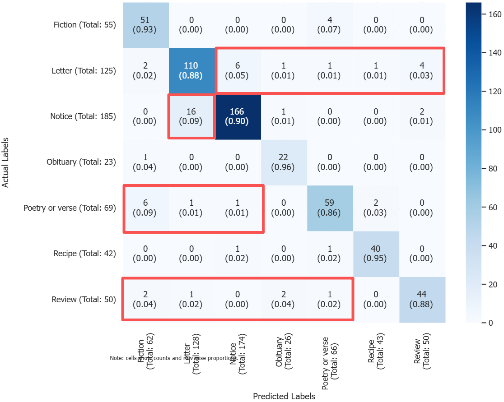
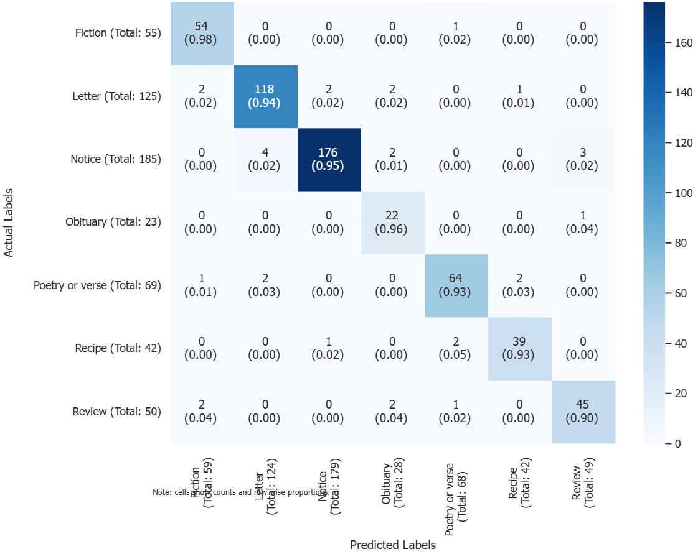
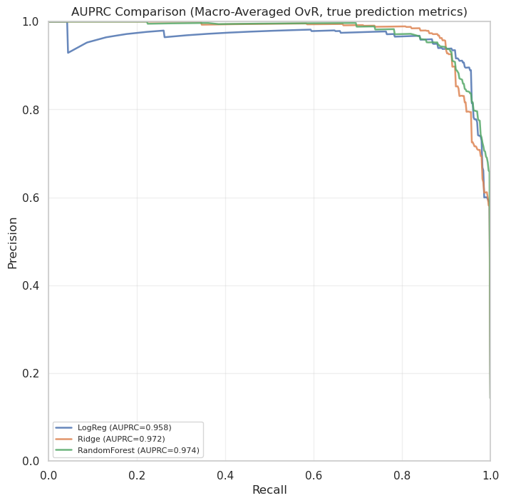

# Historical Newspaper Genre Classification (NLP)

**Can a model recognise genre the way a human reader does, and where does it fail when the meaning of words has moved on?**

This project classifies 19th-century New Zealand newspaper articles from [Papers Past](https://paperspast.natlib.govt.nz/) (National Library of New Zealand) into 7 genres: Fiction, Letter, Notice, Obituary, Poetry or verse, Recipe and Review. Accurate genre labels would let library users search by genre.

The project was about **interpretation, not just a score**. I started from how people recognise genres, built features to match, and then studied the model's mistakes to learn what each genre actually is and why word embeddings struggle with historical text.

## The idea: two kinds of genre

How do we recognise a recipe, compared with a letter to the editor? I grouped the genres by what makes them recognisable:

| Group | Genres | Recognised by | Features used |
|---|---|---|---|
| **Descriptive** | Recipe, Obituary, Fiction | *What* they are about | Word embeddings (meaning of the content) |
| **Prescriptive** | Letter, Notice, Poetry or verse, Review | *How* they are written: form and manner | Text statistics, parts of speech, lexicons and key tokens |

A recipe rarely reads like an obituary, so meaning alone can separate the descriptive genres. A letter, by contrast, can be about anything; what identifies it is its form ("Sir", "To the Editor").

The data backed this up. Word embeddings alone ([Model2Vec](https://github.com/MinishLab/model2vec)) recognised the descriptive genres 93–96% of the time, while the errors bunched up among the prescriptive genres:



*Embeddings only: errors cluster between Notice and Letter, Poetry and Fiction, and across Review (red boxes).*

## Approach: domain-driven feature selection

Rather than adding every available feature and letting the model sort it out, I added small, targeted feature sets one round at a time. Each set was chosen to describe one prescriptive genre, based on reading misclassified articles. I stopped when Macro F1 and AUPRC both stopped improving (round 6).

| Genre | Features that define it (examples) |
|---|---|
| **Poetry or verse** | Many words used only once (rich vocabulary); nouns; "thy"; lexicons for *ancient* and *death* |
| **Notice** | Number of sentences; share of capital letters; "p.m.", "o'clock" |
| **Letter** | Length; "editor", "sir", "letter", "question"; *journalism* lexicon |
| **Review** | Determiners; "book", "audience", "song", "miss"; *achievement* and *positive* lexicons |

The final model added just 25 hand-picked features to the embeddings, and the error clusters largely disappeared:



## Results

| Model | Macro F1 | Macro recall | AUPRC |
|---|---:|---:|---:|
| **Logistic regression** | **0.938** | **0.954** | 0.958 |
| Ridge classifier | 0.928 | 0.937 | 0.972 |
| Random forest | 0.897 | 0.878 | 0.974 |

I chose **recall** as the main goal: for library search, missing a relevant article costs more than showing an extra one. Logistic regression had the best recall and Macro F1, and it keeps precision high when recall is pushed close to 1.



**Robustness to OCR errors:** scanned newspapers are full of character errors. I added simulated OCR errors to the test articles, and Macro F1 only dropped from 0.938 to 0.922.

> **Note on the numbers.** This was an exploratory, interpretation-focused project: misclassified test articles were read to understand genre boundaries. So the scores show how the features behave on this dataset, not a strict estimate of performance on unseen data. A production version would make these choices with cross-validation on the training data and use the test set only once, at the end.

## What the mistakes taught me

Reading the misclassifications was the most useful part of the project:

- **Metaphor breaks embeddings.** One article described preparing an animal's body as "cooking", using one recipe-like word, "roasting". It was classified as a Recipe.
- **OCR noise** ("Ml' John Duthie", "Web lington") corrupts the very tokens a model relies on. Simple rules couldn't fix severe cases.
- **Some genres overlap by nature.** A notice can be written as a letter, and a review can read like fiction. Some "errors" are reasonable alternative readings.

### Why context matters: words as variable names

In programming, a variable name is only a label. What matters is the value stored at the memory address it points to. I find language works the same way: a word is a label, and the real thing is the cognitive pattern it points to in a reader's mind. The mapping between the two isn't stable. It shifts across time, communities and contexts.

This project ran into that problem directly. I used a modern static embedding model on 19th-century newspapers. It gives each word one fixed "address", learned from modern text. Most of the time this worked well. It failed where the mapping had moved: a metaphorical "roasting", or wording that meant something different in the 1880s than it does now.

This is why I think contextual embeddings eventually win. They resolve a word's meaning from its surrounding context, the way a programming language resolves a name by its scope. Even so, they infer meaning from surrounding words rather than reaching the concept itself, so the era and domain of the training text still matter. For historical collections, embeddings trained on historical text would be the natural next step.

## Repository contents

```
notebooks/genre_classification.ipynb   full pipeline, feature rounds, evaluation and error analysis (with outputs)
figures/                               charts used in this README
```

The notebook is kept with its outputs, so it can be read without re-running it.

## Data

- 1,861 articles: 1,312 for training and 549 for testing, from New Zealand newspapers published mostly between the 1840s and early 1900s.
- The genres are imbalanced: Notice is 34% of articles and Obituary only 4%. I up-sampled the training set (`RandomOverSampler`) so that each genre had 453 examples. This raised Macro F1 by 5.2% compared with down-sampling.
- The labelled dataset was provided for the course and is not included here. The original articles are publicly available on [Papers Past](https://paperspast.natlib.govt.nz/).

## Credits

- Solo project for DIGI405 *Texts, Discourses and Data*, University of Canterbury (2025), grade A+.
- Built on the course notebook template and the [textplumber](https://geoffford.nz/textplumber/) package by Geoff Ford ([DIGI405-assignments](https://github.com/polsci/DIGI405-assignments)). My additions are marked with 🍀 in the notebook: the feature sets, model comparison, AUPRC analysis and error analysis.
- Blankenship, A., & Cordell, R. (2024). Word embedding models and the hybridity of newspaper genres. *American Historical Review, 129*(1), 148–152.
- Krüger, K. R., et al. (2017). Classifying news versus opinions in newspapers: Linguistic features for domain independence. *Natural Language Engineering, 23*(5), 687–707.
